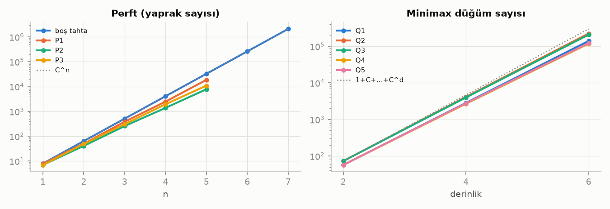
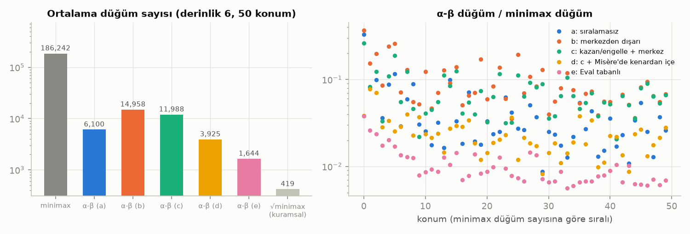
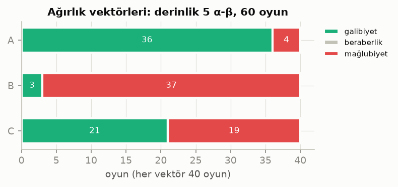
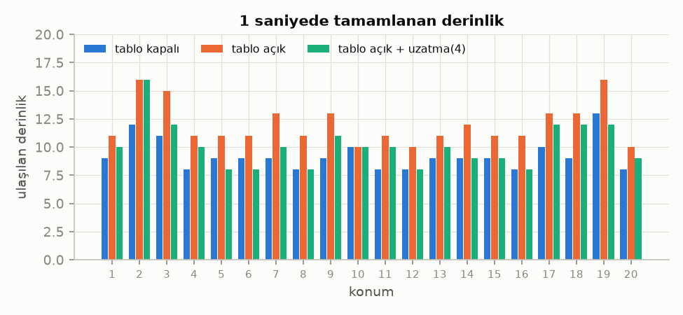
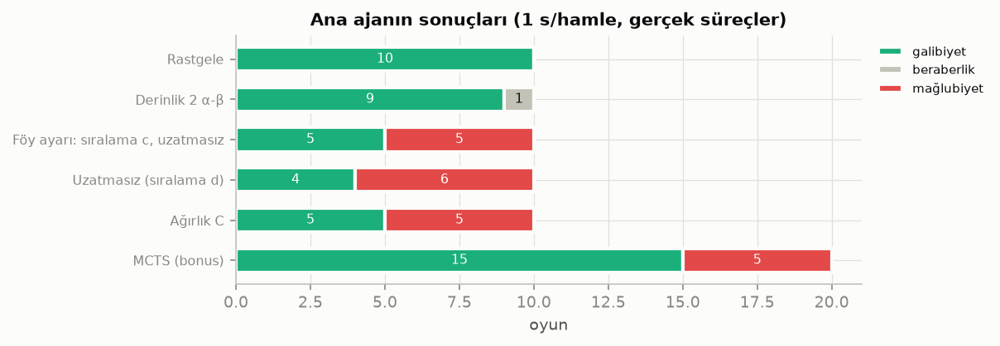

# Connect-K Arena — Rapor

**Varyant: (R, C, K, V, d) = (5, 8, 4, 2, 42)** · öğrenci no 232511042 · 5 satır × 8 sütun, 4'lü dizi, **Misère** (diziyi yapan kaybeder, tahta dolarsa berabere).

Kod ve commit geçmişi: <https://github.com/yunusemretas00/yapayzekaodev>

Makine: Intel Core (Family 6 Model 186), Windows 11, Python 3.12.6. Her sayı `experiments/` altındaki betikle, sabit seed'lerle yeniden üretilebilir (bkz. README). Tüm değerler MAX gözüyledir (minimax, negamax değil).

---

## Aşama 0 — Oyun modeli ve perft

**Tasarım.** Durum değişmez bir `State`: iki oyuncunun taşları iki tam sayının bitleri (`hücre = satır·C + sütun`, satır 0 en alt), `heights[c]` sütunun sıradaki boş satırı, `to_move`, hamle sayısı, son hücre, diziyi yapan oyuncu (`liner`) ve Zobrist anahtarı. `result(s, a)` yeni bir durum döndürür; `s` değişmez (testle sınandı). Kazanma kontrolü: tahtadaki tüm K'lık pencereler **bir kez** bit maskesi olarak listelenir (silindirde sütun `mod C`, engelli hücre içeren pencere hiç üretilmez); taş **konduktan sonra** yalnız o hücreyi içeren pencerelere bakılır. Böylece dört kural aynı kodla çalışır. `utility`: Misère'de `liner`'ın rakibi kazanır.

| konum | n=1 | n=2 | n=3 | n=4 | n=5 | n=6 | n=7 |
|---|---|---|---|---|---|---|---|
| boş tahta | 8 | 64 | 512 | 4 096 | 32 768 | **262 136** | 2 096 752 |
| süre (s) | 0.000 | 0.001 | 0.003 | 0.027 | 0.208 | 1.154 | 9.691 |
| P1 `3 3 4 4 5 5` | 8 | 50 | 386 | 2 483 | 18 686 | | |
| P2 (21 hamle, sütun 6 dolu) | 7 | 41 | 257 | 1 391 | 7 824 | | |
| P3 (19 hamle, sütun 7 dolu) | 7 | 49 | 305 | 1 947 | 10 925 | | |

**Yorum.** (1) R = 5 olduğundan föydeki "n ≤ 6 için perft = Cⁿ" n = 6'da tutmaz: ilk beş hamle aynı sütuna giderse o sütun dolar, 6. hamlede 7 seçenek kalır → 8⁶ − 8 = 262 136 (R = 6 tahtada 7⁶ çıktığını da test ettim). (2) P1 elle doğrulanır: MAX'in 2 ve 6 hamleleri kendi 4'lüsünü tamamlar → terminal (yaprak 1), diğer 6 hamle × 8 = 48 → 50. (3) Model doğruluğu, bilerek yavaş yazılmış bağımsız bir "2B dizi + tüm tahtayı tara" modeliyle 4 varyasyonda 24 yarı dolu konumda perft(1..3) karşılaştırılarak sınandı. Testler (`tests/test_game.py`, 12 test; toplam 42 test, Aşama 0–2 için 25): 4 dizi şekli, sütun dolması, değişmezlik, Misère'de dizenin kaybetmesi, Misère beraberliği, silindir, engelli hücre, ayna stratejisi (Aşama 5).

## Aşama 1 — Minimax

`max_value`/`min_value`: önce `is_terminal → utility`, sonra `depth == 0 → evaluate` (şimdilik 0). Kökte `minimax_decision` merkeze en yakın sütunu (eşitse küçük indeks) seçer → her koşu aynı hamle. Sayaç kök dahil her çağrıda artar.

| konum | d=2 düğüm | d=4 düğüm | d=6 düğüm | b_etkin (d=6) | d=6 süre (s) | hamle (2/4/6) |
|---|---|---|---|---|---|---|
| Q1 `3 3 4 4 5 5` | 57 | 2 838 | 140 301 | 7.21 | 0.60 | 3/3/3 |
| Q2 (11 hamle) | 73 | 4 146 | 224 679 | 7.80 | 1.06 | 3/3/3 |
| Q3 (11 hamle) | 73 | 4 002 | 208 379 | 7.70 | 0.93 | 3/3/3 |
| Q4 (13 h., sütun 7 dolu) | 57 | 2 690 | 118 279 | 7.01 | 0.54 | 3/3/3 |
| Q5 (15 h., sütun 2 dolu) | 57 | 2 773 | 122 740 | 7.05 | 0.54 | 3/3/3 |

**Yorum.** Boş sütunlu konumda d = 2 → 1 + 8 + 64 = 73 (testte doğrulandı). b_etkin = düğüm^(1/d) 7.0–7.8 < C = 8, çünkü (i) dolu sütun dallanmayı 7'ye indirir (Q4, Q5: 1 + 7 + 49 = 57), (ii) Misère'de kendi 3'lüsünü tamamlayan hamleler terminaldir ve altında dal yoktur (Q1: 57), (iii) derinlikle sütunlar dolar. Eval = 0 iken tüm değerler 0'dır; seçilen hamle yalnızca beraberlik kuralından (merkez = 3) gelir. Hız ~220 bin düğüm/s.

## Aşama 2 — α-β, hamle sıralaması, doğruluk

MAX düğümünde `v ≥ β` ise kes, MIN'de `v ≤ α` ise kes (eşitlikte de keserim: değer aynı, daha az düğüm). Kökte her çocuk aynı (α, β) ile çağrılır, α (MIN sıradaysa β) güncellenir. **Doğruluk:** seed 4242'li 50 rastgele konumda derinlik 6'da minimax ve α-β (5 sıralamanın hepsi) **50/50 aynı kök değeri**, seçilen hamlenin gerçek (minimax) değeri kök değerine eşit ve α-β düğümü hiçbir konumda minimax'tan fazla değil. Ek testler: R&N Şekil 5.5 ağacı (değer 3, 11 düğüm), eşitlikte β/α kesmesi, 400 rastgele ağaç, altın düğüm sayıları. **Kontrol noktası 2 provası:** β koşulunda `>=` → `>`, `<=` ya da `>= alpha` değişikliklerinin üçü de testlerle yakalandı (`>` değeri bozmaz, yalnız düğüm sayısını artırır; onu düğüm sayısı testleri yakalar).

Sıralamalar: **a** soldan sağa; **b** merkezden dışarı; **c** önce oyunu bitiren hamle (Standart'ta kazanç önce, Misère'de kendi dizisini tamamlayan "intihar" en sona), sonra rakibin hücresini kapatma, sonra merkez; ölçümden sonra eklediğim **d** = c ama Misère'de kenardan içe; **e** = çocukların statik Eval'ine göre.

| derinlik 6, 50 konum | Eval = 0: ort. düğüm | gerçek Eval: ort. düğüm | gerçek Eval: minimax'a oran | b_etkin | sıralama çağrısı (µs) |
|---|---|---|---|---|---|
| minimax | 186 242 | 186 242 | 100 % | 7.39 | – |
| a sıralamasız | 1 506 | 6 100 | 4.3 % | 4.17 | 0.1 |
| b merkezden dışarı | 1 568 | 14 958 | 9.6 % | 4.86 | 0.7 |
| c kazan/engelle + merkez | 1 375 | 11 988 | 7.2 % | 4.65 | 4.3 |
| **d** c + Misère'de kenardan içe | 1 389 | **3 925** | 2.4 % | 3.90 | 6.3 |
| **e** Eval tabanlı | 1 415 | **1 644** | 1.1 % | 3.40 | 45.7 |
| kuramsal en iyi √(minimax) = b^(m/2) | | 419 | | | |

**Yorum.** *Eval = 0 iken* yaprakların neredeyse hepsi 0 olduğundan ilk çocuk değeri hemen β'ya eşit olur ve `v ≥ β` keser; sıralamanın önemi kalmaz (~%1). Gerçek Eval ile beklenen sıra c < b < a **tersine** çıktı: merkezden başlayan b ve c, sıralamasızdan kötü. Nedeni Misère: merkez hücre daha çok pencereye girer, kendi K−1'lik (zehirli) pencerelerini çoğaltır; iyi hamleler çoğunlukla kenardadır. En az budanan konum (`5 1 1 5 0 0 2 6 5 1 1 0 4 0 1 2 4 5 0 6`, oran a 0.33, c 0.26): en iyi hamle 7 numaralı kenar sütun, a ve c onu **en son** inceler; d onu ilk sıraya koyar (oran 0.077). Bu ölçüm üzerine eklediğim d, düğüm sayısını c'ye göre 3 kat azalttı; e kuramsal en iyi duruma (419) en çok yaklaşan sıralama (3.9 katı), ama çağrı başına 46 µs. Süre sınırında durum farklı (`exp4_orderings.py`, tablo açık, 20 konum × 1 s; bilgisayar pilde ve kısılmışken ölçüldü, mutlak hızlar düşük ama hepsi aynı koşulda): ortalama derinlik a 10.05, d 9.75, b 9.00, c 8.95, e 8.20. Tablonun ilk denettiği hamle sıralamanın faydasının çoğunu zaten sağlıyor; pahalı sıralama (e) ise saniyedeki düğüm sayısını 4–5 kat düşürüyor. Ajanda **d** kullanıyorum: süre sınırında a ile başa baş, sabit derinlikte ise 1.6 kat daha az düğüm.

## Aşama 3 — Değerlendirme fonksiyonu

`Eval(s) = 0.999·tanh(Σ wᵢfᵢ / 6)` ∈ (−1, 1), yani gerçek kazanç/kayıptan (±1) her zaman küçük. Pencereler Game'de bir kez hesaplanır (bu tahtada 61 pencere); bir çağrı **~20 µs** (bit işlemleri + `bit_count`).

| öznitelik | tanım (iki tarafın taşı olan pencere sayılmaz) |
|---|---|
| f1 / f3 | MAX'in / MIN'in K−1 taşı + 1 boş pencere sayısı (Misère'de: kendi zehirli hücreleri) |
| f2 / f4 | MAX'in / MIN'in K−2 taşı + 2 boş pencere sayısı |
| f5 | merkez sütunlarda (3, 4) MAX taşı − MIN taşı |
| f6 *(Misère'e özgü)* | "dizmeye zorlanmayacağım" göstergesi: MAX'in **güvenli** oynanabilir sütun sayısı − MIN'inki (güvenli = taşın düşeceği hücre kendi dizimi tamamlamıyor). Misère'de güvenli hamlesi önce biten kaybeder (zugzwang); f6 bunu doğrudan ölçer. |

Elle doğrulama (`python evaluate.py "3 3 4 4 5 5"`, kontrol noktası 3 için): f1 = 2 ({2-5}, {3-6}), f2 = 2 ({1-4}, {4-7}), f3 = f4 = 2, f5 = 0, f6 = 6 − 8 = −2 → ham −1.0, Eval = −0.165; program aynı sayıları verdi.

**Ağırlık ayarı.** Üç vektör; her çift her iki yönde 10'ar oyun; iki taraf derinlik 5 α-β (sıralama c); ilk 4 hamle seed'li rastgele (oyun i için seed 3000 + i, aynı açılış iki yönde de oynandı).

| vektör | f1 | f2 | f3 | f4 | f5 | f6 | A'ya karşı | B'ye karşı | C'ye karşı | toplam G (/40) | tahminim |
|---|---|---|---|---|---|---|---|---|---|---|---|
| **A** ters-simetrik | −1 | −0.25 | +1 | +0.25 | 0 | +0.5 | — | 19-1 | 17-3 | **36** | en iyi / C ile başa baş |
| B standart işaretler | +1 | +0.25 | −1 | −0.25 | +0.15 | 0 | 1-19 | — | 2-18 | 3 | en kötü |
| C güvenli hamle ağır | −0.5 | 0 | +0.5 | 0 | 0 | +1.5 | 3-17 | 18-2 | — | 21 | A'ya yakın |

**Yorum.** Misère'de K−1 ağırlığının işaretinin ters olması gerektiği ölçümle doğrulandı: standart işaretli B 40 oyunda 3 kazandı (kendi 3'lülerini kurup sonra dizmeye zorlanıyor). C'yi A'ya yakın tahmin etmiştim ama 3-17 kaybetti: f6 yalnız *şu an* oynanabilir hücrelere bakıyor; pencere sayıları (f1–f4) ileride zehirlenecek hücreleri de görüyor. Ajan A'yı kullanıyor. İlginç yan bulgu: 60 oyunun 36'sını **ikinci** oyuncu kazandı (Aşama 5'te açıklanıyor). *Simetri:* Standart ve Misère'de ayna konum aynı Eval'i verir (40 konumda test). Silindirde "merkez" anlamsız olduğundan f5 = 0 alınır; döndürülmüş konum aynı Eval'i verir. Engelli varyantta tahta simetrik değildir: engel bir yanda pencereleri siler, ayna konum farklı Eval alır.

## Aşama 4 — Zaman sınırlı arama

**İteratif derinleşme:** derinlik 1, 2, 3, …; önceki derinliğin en iyi hamlesi kökte ilk sırada. Süre her 1000 düğümde bir `perf_counter` ile kontrol edilir; dolunca `TimeUp` istisnası köke kadar fırlar, yarım derinlik **atılır**, son tamamlanan derinliğin hamlesi döner. *Yarım sonuç neden yanıltıcı:* yarım iterasyon yalnızca ilk birkaç kök hamlesini inceler; diğer hamlelerin değeri yoktur, ayrıca derin arama ilk hamlenin daha kötü olduğunu keşfetmişse bunu görür ama alternatifleri görmeden döner. Kanıtlanmış kazanç (±1) bulununca durulur (ID en kısa kazancı ilk bulur); kanıtlanmış kayıpta bir önceki derinliğin (en uzun direnen) hamlesi korunur.

**Yer değiştirme tablosu:** Zobrist (seed'li 64-bit sayı × hücre × oyuncu, artımlı XOR; sıra bilgisi için ayrıca `side_key`; `3 5 4` ve `4 5 3` aynı anahtar, testli). Kayıt: `(derinlik, değer, bayrak, en iyi hamle)`; bayrak, gerçekten aranan pencereye göre EXACT / LOWER (β kesmesi) / UPPER (α'yı geçemedi); okurken yalnız `kayıtlı derinlik ≥ gereken derinlik`; kayıtlı hamle her zaman ilk denenir. **Doğruluk:** tablo açıkken derinlik-6 değeri 50/50 konumda düz α-β ile aynı (+ 45 test konumu, Standart varyant dahil).

| 20 konum, 1 s/hamle (gc kapalı) | ort. derinlik | min–maks | ort. düğüm | düğüm/s | en yavaş hamle |
|---|---|---|---|---|---|
| tablo kapalı | 9.25 | 8–13 | 156 869 | 160 079 | 1.835 s* |
| **tablo açık** | **12.00** | 10–16 | 156 096 | 185 505 | 1.006 s |
| tablo + uzatma(4) | 10.10 | 8–16 | 153 089 | 185 220 | 1.011 s |

\*İki ayrı koşuda birer kez (2.02 s ve 1.84 s) görüldü; aynı konum tek başına 5 kez 1.002–1.005 s. `exp4_stress.py` her aramada süre kontrolleri arasındaki en büyük boşluğu da ölçüyor: 120 aramada en uzun 1.012 s, en büyük boşluk 15.7 ms. Yani bu, kodun süre kontrolünden değil, işletim sisteminin süreci bekletmesinden kaynaklanıyor. Bu yüzden ajanın iç bütçesi 0.8 s.

**Kontrol noktası 4** (`data/positions_stage4.txt`, ajan ayarı, 0.8 s): derinlikler T1–T10 = 16, 10, 8, 10, 8, 8, 11, 9, 8, 14 (T1'de kanıtlanmış kazanç derinlik 16'da, 0.45 s'de bulundu; açılış konumlarında 8, oyun ilerledikçe dallanma azaldığından 10–16); en uzun hamle 0.805 s.

**Ufuk etkisi** (`exp4_horizon.py`). Sabit derinlik 4 ajan kendine karşı 30 oyun oynadı; her hamlesi derinlik 9 aramayla denetlendi. **10 kötü hamle** bulundu (seçilen hamle kanıtlanmış kayba gidiyor ama kaybetmeyen bir hamle var). Örnek (sıra X'te, `0 0 3 4 0 0 0 7 7 7 7 7 5 6 6 6 3 1 2 1 2 6 6 1`): derinlik 4, 6, 7, 8 → hamle **2**; derinlik 9 → **5** (değer −0.761). Derinlik 9'a göre 2 kanıtlanmış kayıp. 2'yi kaybettiren zorunlu dizi 8 yarı-hamleden uzun; derinlik 8'e kadar ufkun ötesinde kalıyor, Eval de kaybı "biraz kötü" (−0.165) olarak değerlendiriyor. **Düzeltme:** derinlik sınırında konum sakin değilse (oynanabilir bir hücre herhangi bir oyuncunun dizisini tamamlıyorsa) aramayı 1 yarı-hamle uzatırım, bir yolda en çok 4 kez. Derinlik 4 + uzatma bu konumda 3'ü seçiyor (kaybetmiyor); 10 kötü hamlenin 8'ini düzeltiyor.

| derinlik 4, 60 oyun (eşli açılış) | galibiyet | kötü hamle | düğüm/hamle | ms/hamle |
|---|---|---|---|---|
| uzatmasız (önce) | 21 | 7 | 206 | 3 |
| uzatma = 4 (sonra) | **36** | **3** | 1 187 | 21 |

Bedel: aynı sürede ulaşılan nominal derinlik ~2 yarı-hamle azalıyor (12.0 → 10.1). Turnuva sonucu (Aşama 5) bu takası değerlendiriyor.

## Aşama 5 — Turnuva ve savunma

**Ajan** (`agent.py`): `--R --C --K --V --seed` (seed = engelli hücre çekimindeki d) alır; `MOVES …` satırında konumu baştan kurar ve ID α-β ile arar: tablo, sıralama d, uzatma 4, ağırlık A (diğer varyantlarda standart ağırlıklar; silindirde f5 = 0). Cevaptan sonra `flush` eder, hata ayıklama çıktısı stderr'e gider. *Güvenlik:* süre satırın okunduğu anda başlar. İç bütçe 0.8 s, ilk komutta 0.55 s: hakem süreci açar açmaz MOVES gönderirse Python'un açılışı da süreye sayılır; bu düzeltmeden önce ilk hamle 0.92 s'ye çıkmıştı. Arama çöp üretmediği için `gc` kapalı. Hata olursa merkeze en yakın yasal sütun yazılır; hiç yasal hamle yoksa `0` yazılır, ajan çökmez (testli). `arena.py`, iki ajan **sürecini** bu protokolle oynatan bir hakem: süreyi, MOVES yazılmasından cevabın okunmasına kadar dışarıdan ölçer.

**Beklenmedik varyantlar** (`exp5_variants.py`, ana ajan vs rastgele): 7×8 K=5, 6×7 K=4 ve 5×6 K=4 tahtalarda V = 0, 1, 2, 3'ün hepsi. 24 oyunun 24'ü kazanıldı; yasa dışı hamle ve süre aşımı 0; en yavaş hamle 0.664 s. Ayrıca `tests/test_agent.py`: QUIT, tek yasal sütun, yasal hamle yokken çökmeme, K=5 / R=7 / C=8 ve her V.

**Yerel turnuva** (`exp5_tournament.py`, 1 s/hamle, gerçek süreçler, 5 oyun paralel, ilk 2 hamle seed'li 900 + i//2, her rakibe karşı yarı oyunlarda önce başlayarak):

| rakip | oyun | G | B | M | G: önce / ikinci | ana ajan en yavaş hamle |
|---|---|---|---|---|---|---|
| rastgele | 10 | 10 | 0 | 0 | 5 / 5 | 0.653 s |
| sabit derinlik 2 α-β | 10 | 9 | 1 | 0 | 4 / 5 | 0.704 s |
| föy ayarı (sıralama c, uzatmasız) | 10 | 5 | 0 | 5 | 0 / 5 | 0.734 s |
| uzatmasız (sıralama d) | 10 | 4 | 0 | 6 | 0 / 4 | 0.774 s |
| ağırlık C | 10 | 5 | 0 | 5 | 1 / 4 | 0.716 s |
| MCTS (bonus) | 20 | 15 | 0 | 5 | 6 / 9 | 0.662 s |

70 oyunda süre aşımı ve yasa dışı hamle 0, en yavaş hamle 0.774 s. (Uzatmasız serisinin ilk koşusunda bilgisayar ~7 dakika askıya alındı ve 5 paralel oyun aynı anda "423 s" ölçtü; bu ortam olayı olduğu için seri yeniden oynandı. Ham kayıt `results/stage5_tournament_run_with_sleep.json`.)

**En önemli bulgu: bu varyantta ikinci oyuncunun kaybetmeyen bir stratejisi var.** Ana ajan ikinci oynadığında 35 oyunun 32'sini kazandı, ilk oynadığında 16'sını. Aşama 3'te de 60 oyunun 36'sını ikinci kazanmıştı. Bunun kuramsal nedeni: **C çift ve engel yoksa, Misère'de ikinci oyuncu ayna stratejisiyle (rakip c'ye oynarsa C−1−c) asla ilk diziyi yapan olmaz.**

*Kanıt taslağı:* Her ikinci hamleden sonra tahta, renkleri yer değiştirmiş ayna simetrisindedir; ayna hamlesi her zaman yasaldır, çünkü iki sütunun yüksekliği eşittir. O, c* hücresiyle bir L dizisi tamamlasaydı, L'nin aynası X'in bir dizisi olurdu ve bu dizi X'in az önce oynadığı m(c*) hücresini içerirdi. Yani X bir hamle önce dizisini tamamlamış ve oyun bitmiş olurdu. Kendi aynasına eşit tek diziler merkezi kesen yatay dizilerdir; onlar da hem X hem O içerir.

`test_misere_mirror_strategy_never_loses` bunu 300 rastgele oyunda sınıyor; 1000 oyunluk denemede rastgele ilk oyuncular aynaya karşı 0 kez kazandı. Ana ajan ilk oyuncu olarak aynaya karşı 10/10 berabere kaldı; bu, ulaşılabilecek en iyi sonuç. Yani turnuvada ilk başladığım oyunlarda kazanç ancak rakibin hatasından gelebilir.

**Yenilgi analizi** (föy ayarı rakibine karşı oyun 0; ana ajan X, önce başladı):
`3 5 5 5 7 6 5 5 0 4 0 0 7 7 7 7 2 2 2 3 2 2 3 0 0 1 1 1 1 1 6 6 6 6 3`. X 35. hamlede 4'lü yapmaya zorlandı (zugzwang).

* *Hata hangi hamlede?* Her X hamlesi önce 6 s'lik, sonra 20–40 s'lik derin aramayla yeniden değerlendirildi. 13. hamlede (X 7 oynadı) konum derinlik 16'da hâlâ kanıtlanmamış (−0.358), derin arama da 7'yi seçiyor. 15. hamlede (X 7) konum derinlik 16'da **kanıtlanmış kayıp** (−1, tüm hamleler). 17. hamlede derinlik 14 yetiyor. Oyun, 13–15. hamleler arasında, ajanın gördüğünden en az 6 yarı-hamle derinde kaybedildi. Ajan bu konumlarda 0.8 s'de ~10 derinliğe iniyordu; derinlik 8–12'nin hepsi 17. hamlede 0'ı "−0.2…−0.3" olarak görüyor, kayıp ancak derinlik 14'te ortaya çıkıyor.
* *Hangi karar yol açtı?* (1) **Derinlik:** Python'da ~185 bin düğüm/s ile 1 s'de 10–12 yarı-hamle derinliğe iniliyor. Misère'de kayıplar 20+ yarı-hamle sonraki zugzwang'dan geliyor (kayıp oyunlar 31–37. hamlede bitti). (2) **Eval:** f1–f6 zehirli hücreleri sayıyor ama hangi oyuncunun onları **doldurmaya zorlanacağını** (sıra/parite) bilmiyor. Bu konumda Eval −0.2 ile −0.3 arasında; kayıp konumla eşit konumu ayıramıyor. (3) Kuramsal olarak ilk oyuncu dezavantajlı (yukarıdaki teorem).
* *Bir sonraki sürümde ne değiştirirdim?* **Parite/zugzwang özniteliği:** her zehirli hücre için, oyun "güvenli hücreler bitene kadar" oynanırsa onu kimin doldurmak zorunda kalacağını, satırın ve kalan boş hücre sayısının paritesinden tahmin eden bir öznitelik. Bunu daha hızlı bir motora (bitboard + C/Numba) tercih ediyorum. Gerekçe: hız 2–3 kat artarsa derinlik ancak 1–2 yarı-hamle artar, kayıp ise 6+ yarı-hamle derinde. Doğru bir parite bilgisi ise kaybı "ufkun ötesinden" Eval'e taşır; Aşama 3'te öznitelik değişikliği (B → A) 3/40'tan 36/40'a çıkarmıştı. İkinci oyuncuyken "arama kanıtlanmış kazanç görmedikçe ayna hamlesi" kuralı kaybı imkânsız kılar (ikinci oynadığım 35 oyunda 3 kayıp vardı). Ancak aramam simetriyi genellikle ilk hamlede bozuyor, yani bu kural kazançların bir kısmını beraberliğe çevirebilir; bu takası ölçmeden benimsemezdim.

*(Sınıf turnuvası yapılmadığı için yenilgi analizi, aynı protokol ve 1 s sınırla oynanan yerel turnuvadan seçildi.)*

## Bonus — Monte Carlo ağaç araması

`mcts.py`: UCT (c = √2). Simülasyon politikası hafif akıllı: Standart'ta oyunu bitiren hamleyi alır, Misère'de kendi dizisini tamamlayan hamleden kaçınır, yoksa rastgele oynar. Karar en çok ziyaret edilen çocuktur; 0.8 s'de ~7 000 simülasyon. Aynı protokol ve 1 s ile **α-β ana ajan – MCTS: 15 – 5** (α-β ilk başlarken 6/10, ikinci oynarken 9/10). MCTS, avantajlı ikinci oyuncu konumundayken bile 10 oyunun 6'sını, ilk oyuncuyken 9'unu kaybetti. Misère'de rastgele simülasyonlar zugzwang sonlarını çok gürültülü değerlendiriyor: rastgele oyuncu kendini dizmeye çabuk zorlanır, oysa gerçek oyunda iki taraf da zehirli hücrelerden kaçınır. α-β ise sonlara yaklaştıkça oyunun sonuna kadar arayıp kesin oynuyor (kontrol noktası 4'te derinlik 14–16).

Kontrol noktaları için hazır komutlar README'de.
